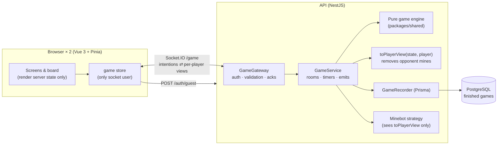

# Minefall

**A real-time 2-player strategy game: drop tokens, line up four, and beware of your
opponent's hidden mines.** Built with NestJS + Socket.IO, Vue 3 and TypeScript end to end,
with a server-authoritative design that keeps each player's mines secret.

[](https://github.com/ghofrane-soulmi/MineFall/actions/workflows/ci.yml)

**Live demo:** _coming soon_ · no account needed: pick a nickname, then share a room link
or play solo against **Minebot**.


## How to play

1. Each player secretly hides **2 mines** on the 7 × 6 board (never on the top row).
2. Players take turns dropping tokens; gravity takes them to the lowest free cell.
   **Four in a row** (horizontal, vertical or diagonal) wins.
3. Land on **your opponent's mine** and it explodes: your token is destroyed, the mine is
   revealed and the column is blocked for one turn. **Your own mines never hurt you.**

Who starts is decided by a dice roll (two dice each, highest total plays red).

## Features

- Guest play in seconds: nickname only, private rooms with a 6-character code, link and QR code
- **Spectator mode:** open the link of a full room to watch the game live (read-only chat). Spectators
  receive no mines at all until the game is over
- **Quick match:** "Play now" pairs you with the next waiting player (Minebot is offered after
  30 s if nobody comes)
- **Play solo against Minebot** (easy or normal): it wins when it can, blocks your threats, avoids
  gifting you a win and hides its mines where people play early. It decides from the same
  filtered view a human gets, so it cannot see your mines
- Real-time play over WebSockets with server-side timers (30 s placement, 20 s per turn)
- **Reconnection:** refresh the page mid-game and you are back where you were; a player who
  stays away more than 60 s forfeits
- Quick chat (presets, emoji reactions floating over the board, free text), rate limited
- Rematch with the starting player swapped; finished games saved to PostgreSQL
- Animations (gravity drop, explosion flash + board shake, pulsing winning line), mobile
  layout, keyboard play (← → Enter), screen-reader announcements, colour-blind-friendly tokens

## Architecture



```
minefall/
├─ packages/shared   @minefall/shared: game engine, event names, payload types, validators
├─ apps/api          NestJS + Socket.IO server, Prisma, Docker image
├─ apps/web          Vue 3 + Pinia + Tailwind client, Playwright E2E
├─ deploy/           VPS guide + host Nginx (HTTPS, WebSocket upgrade)
└─ docker-compose.yml  postgres · migrate · api · web
```

- **One source of truth for the rules.** The engine is pure TypeScript (no I/O, no timers, no
  randomness of its own) in `packages/shared`, shared by server and client types.
- **One source of truth for the protocol.** Event names and payload types live in the shared
  package and type Socket.IO on both sides; a typo in an event name does not compile.
- **Live games in memory, history in PostgreSQL.** Rooms are a `Map` on the server (Redis is
  the next step for several instances); only finished games are written, in one transaction.

## How the server keeps mines secret

The interesting problem in this game is **hidden information**: if the opponent's mines ever
reached the browser, anyone could read them in the network tab. So:

1. **The server is the only authority.** Clients send intentions (`move:drop { column, turnId }`).
   The server validates turn, phase, column and `turnId`, runs the engine, resolves mines and
   broadcasts the result. Invalid actions get an error acknowledgement and change nothing.
2. **The full game state never leaves the server.** Every game payload is built by
   `toPlayerView(state, playerId)`, which copies an explicit allow-list of fields: your own
   mines, exploded (public) mines, the board, and nothing else. The opponent's unexploded
   mines are only revealed when the game ends.
3. **It is tested at three levels:**
   - engine: 300 random full games, checking every view at every move;
   - service: every event each player receives is scanned for the opponent's mines;
   - network: two real Socket.IO clients play a game while all received traffic is recorded
     and scanned before game over.
4. **Clients never compute outcomes.** The browser copies what the server decided (landing
   row, explosion, blocked columns, next player) and resynchronises from a full per-player
   state on reconnect. Timers are server-side; clients only display `endsAt`.

## Run it locally

**Everything with Docker (one command):**

```bash
docker compose up --build
# open http://localhost:8090 in two windows (e.g. one normal, one private)
```

**Development (hot reload):** Node ≥ 22 and pnpm 10 (`npm i -g pnpm@10`).

```bash
pnpm install
docker compose up -d postgres                 # database on localhost:5442
cp apps/api/.env.example apps/api/.env        # then: pnpm --filter @minefall/api db:migrate
pnpm --filter @minefall/api dev               # API on :3000
pnpm --filter @minefall/web dev               # web on :5173 (proxies the API)
```

The API also runs without a database: without `DATABASE_URL` it simply does not save games.

## Tests

```bash
pnpm test                               # engine, API (unit + real sockets), web
pnpm --filter @minefall/web test:e2e    # Playwright: two browsers play a full game
pnpm lint && pnpm typecheck
```

| Layer  | Tool                                   | What is covered                                                                                         |
| ------ | -------------------------------------- | ------------------------------------------------------------------------------------------------------- |
| Engine | Vitest (≥ 90 % coverage gate)          | gravity, wins in 4 directions, draws, mines, blocked columns, timeouts, mine secrecy                    |
| API    | Vitest + Supertest + Socket.IO clients | rooms, timers, reconnection, forfeits, chat limits, full games over the network, PostgreSQL persistence |
| Web    | Vitest + Vue Test Utils                | store event handling, board interaction & keyboard, chat, countdown                                     |
| E2E    | Playwright                             | two browser contexts create, join and finish a game, with a page refresh mid-game                       |

CI (GitHub Actions) runs lint, typecheck, all tests against a real PostgreSQL, the E2E test
and the Docker builds on every push. Deployment: see [deploy/README.md](deploy/README.md).

## Tech stack

TypeScript (strict) · NestJS 12 · Socket.IO 4 · Vue 3 · Pinia · Vue Router · Tailwind CSS 4 ·
Vite 8 · Prisma 7 + PostgreSQL 17 · Vitest · Playwright · Docker Compose · Nginx · GitHub Actions
